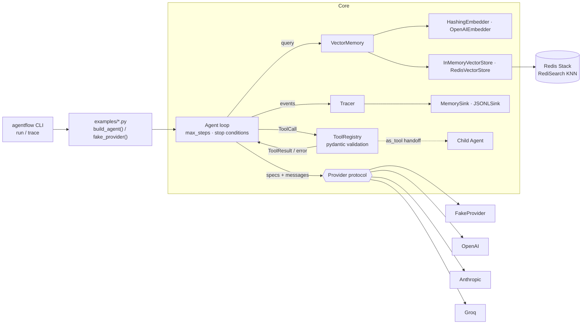

# AgentFlow

[](https://github.com/tatitoxt/agentflow/actions/workflows/ci.yml)
[](LICENSE)

A lightweight, typed Python (3.11+) framework for tool-calling AI agents: an explicit agent
loop, schema-validated tools, pluggable LLM providers, vector memory and JSONL tracing.
Everything runs offline by default against a deterministic scripted provider.

> Status: v0.1, a portfolio/learning project. It is not used in production and has no
> external users. See [Limitations](#limitations).

## Problem

Small tool-calling agents tend to start as glue code: a loop around a chat API, hand-written
JSON schemas for tools, string-matching for errors and `print` debugging. Large frameworks
fix that but bring big dependency trees and abstractions that are hard to read and test.
AgentFlow keeps the loop small and explicit, makes every step an inspectable event, and lets
you test agents without API keys.

## What it does today

- **Agent loop** (`agentflow.Agent`): alternates provider and tool calls until a final
  answer, a stop condition (`stop_after_tool`, `max_tool_calls` or your own, checked after
  every tool call) or `max_steps`. Answers cut off by the provider's token limit end with
  `stop_reason="truncated"`, not `final_answer`.
- **Tool registry** (`@tool`): JSON schema generated from type hints, `Annotated[..., Field()]`,
  Google-style docstrings or a single pydantic model parameter; arguments are validated
  (extra fields rejected) before the function runs.
- **Tool error handling**: validation errors, exceptions and unknown tools are returned to the
  model as error results so it can recover; `raise_on_tool_error=True` aborts instead.
- **Tracing**: typed events (`run_start`, `memory_retrieval`, `provider_request`,
  `provider_response`, `tool_call`, `tool_result`, `tool_error`, `handoff_start`,
  `handoff_end`, `run_end`, `run_error`) streamed to sinks; JSONL export and reload.
- **Providers** behind one `Provider` protocol, all over `httpx` (no vendor SDKs):
  `OpenAIProvider` (Chat Completions), `AnthropicProvider` (Messages API), `GroqProvider`
  (OpenAI-compatible), with retry/backoff on 408/409/429/5xx, plus `FakeProvider` (scripted,
  deterministic). Real providers are opt-in via env vars.
- **Vector memory**: `HashingEmbedder` (offline, deterministic) or `OpenAIEmbedder` (opt-in);
  `InMemoryVectorStore` or `RedisVectorStore` (Redis Stack / RediSearch KNN index, persistent).
  Retrieved snippets are injected into the agent context with their source.
- **Multi-agent handoff**: `agent.as_tool()` exposes an agent as a tool; the child run shares
  the parent's trace and records `parent_run_id`.
- **CLI**: `agentflow run examples/<name>.py` and `agentflow trace <file.jsonl>`.

## Quickstart

Requires Python 3.11+ and [uv](https://docs.astral.sh/uv/) (or plain `pip`).

```bash
git clone https://github.com/tatitoxt/agentflow.git
cd agentflow
uv sync --frozen --extra dev          # or: python -m venv .venv && .venv/bin/pip install -e '.[dev]'

# RAG over the synthetic handbook in examples/data/handbook
uv run agentflow run examples/research_assistant.py -i "How long do refunds take?"

# Ticket triage with a billing-specialist handoff, writing a JSONL trace
uv run agentflow run examples/ticket_triage.py --trace traces/triage.jsonl
uv run agentflow trace traces/triage.jsonl
```

Expected output (deterministic, no API key needed):

```text
Refunds for duplicate or incorrect charges are processed within 5 business days of approval. [source: billing.md]
Filed TCK-0001 (category=billing, priority=P2, plan=pro). Billing specialist: Duplicate charge: INV-1003 repeats INV-1002 (2026-11-01, $29.00); recommend refunding $29.00.
```

Try the failure path (unknown customer → `lookup_customer` fails → the agent recovers):

```bash
uv run agentflow run examples/ticket_triage.py \
  -i $'From: zed@unknown.test\nSubject: App is down\nEvery page returns error 500.'
```

Useful flags: `--json` (machine-readable summary), `--max-steps N`, `--provider
fake|openai|anthropic|groq`. Exit codes: `0` finished, `1` error, `3` stopped early
(for example `max_steps` or `truncated`).

### Using a real model (opt-in)

```bash
export AGENTFLOW_PROVIDER=anthropic ANTHROPIC_API_KEY=...   # or openai + OPENAI_API_KEY, groq + GROQ_API_KEY
export AGENTFLOW_MODEL=...                                   # optional model override
uv run agentflow run examples/research_assistant.py -i "Is SSO available?"
```

The test suite never calls a real provider; adapters are tested against recorded wire formats
with `httpx.MockTransport`.

### Redis-backed memory

```bash
docker compose up -d --wait redis
AGENTFLOW_REDIS_URL=redis://localhost:6379/0 \
  uv run agentflow run examples/research_assistant.py -i "What is the API rate limit?"
```

## Library usage

```python
from agentflow import Agent, tool
from agentflow.memory import HashingEmbedder, InMemoryVectorStore, VectorMemory
from agentflow.providers import FakeProvider


@tool
def get_weather(city: str) -> str:
    """Current weather for a city.

    Args:
        city: City name, e.g. "Lima".
    """
    return {"Lima": "18C, cloudy"}.get(city, "unknown")


memory = VectorMemory(HashingEmbedder(), InMemoryVectorStore())
memory.add("Lima is foggy in winter.", {"source": "notes.md"})

provider = FakeProvider([
    FakeProvider.tool_call("get_weather", city="Lima"),
    lambda messages, tools: f"It is {messages[-1].content} in Lima.",
])
agent = Agent("weather", provider, tools=[get_weather], memory=memory, max_steps=4)
result = agent.run("What's the weather in Lima?")
print(result.output, result.stop_reason)   # It is 18C, cloudy in Lima. final_answer
```

Swap `FakeProvider` for `OpenAIProvider.from_env()`, `AnthropicProvider.from_env()` or
`GroqProvider.from_env()` to use a real model.

## Architecture



One run: `run_start` → optional `memory_retrieval` (top-k snippets injected as a system
message) → for each step `provider_request`/`provider_response`, then each requested tool is
validated and executed (`tool_call` → `tool_result` | `tool_error`) → stop on a final answer,
a stop condition or `max_steps` → `run_end`.

Code map: `src/agentflow/agent.py` (loop, stop conditions, handoff), `tools.py`,
`tracing.py`, `providers/`, `memory/`, `cli.py`. Design notes: [spec](docs/spec/agentflow.md),
[ADR 0001](docs/adr/0001-core-decisions.md).

## Tests

```bash
make lint typecheck            # ruff check, ruff format --check, mypy --strict (src + examples)
make test                      # unit + integration (Redis tests skip without a server)
make test-redis                # starts Redis Stack with docker compose, runs everything incl. Redis
make e2e                       # spawns the real `agentflow` CLI on both examples
make audit                     # pip-audit on the locked dependency set
```

| Suite | Count | What it covers |
|-------|------:|----------------|
| `tests/unit` | 63 | tools/schemas, providers' wire formats and retries, loop, stop conditions, errors, handoff, memory, tracing, CLI, README example |
| `tests/integration` | 4 | `RedisVectorStore` KNN, persistence across instances, clear, agent retrieval from Redis |
| `tests/e2e` | 8 | `agentflow run` / `agentflow trace` as subprocesses: outputs, exit codes, JSONL traces, tool-failure recovery, Redis-backed RAG |

Counts are from `pytest --collect-only` on this commit. CI runs all 75 on Python 3.11 and
3.12 with a `redis/redis-stack-server` service container (`AGENTFLOW_REQUIRE_REDIS=1` makes
Redis tests fail rather than skip), plus a `pip-audit --strict` job.

## Limitations

- **The demo "intelligence" is scripted.** The examples' `FakeProvider` policies are small
  rule-based functions; they show the loop, tools, retrieval and handoff working, not model
  quality. Real-provider behaviour depends on the model and was not evaluated here.
- **Real providers are not exercised against live APIs** in tests or CI; only their request /
  response formats are tested with mocked HTTP. Streaming, vision and parallel-tool-call
  options are not implemented.
- **HashingEmbedder is lexical**, not semantic: it matches overlapping words, not meaning.
- **RedisVectorStore needs Redis Stack (RediSearch)**; plain Redis is not supported. The index
  dimension is fixed at creation; changing embedders requires a new index name.
- Synchronous API only; tools run sequentially; no token budgeting or context truncation.
- No benchmarks were run; no performance claims are made.

## Roadmap

- Async API and parallel tool execution.
- Streaming responses and token/cost budgets as stop conditions.
- Context-window management (summarizing or truncating long histories).
- Opt-in live smoke tests against real providers (manual workflow with secrets).
- More stores (pgvector) and a plain-Redis fallback store.

## License

[MIT](LICENSE) © Fausto Pastura
